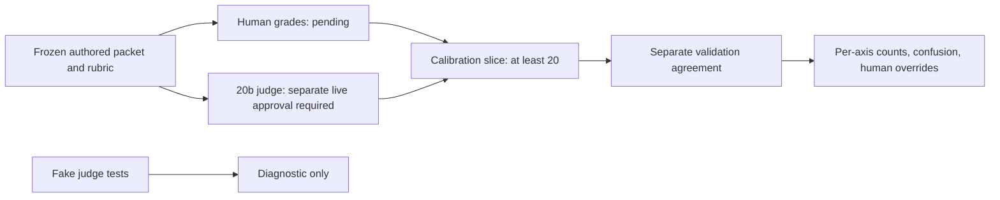

# Phase 8 — Evaluation inputs and reproducible evidence

Incremental study guide. Increments 1–3 and Increment 4's offline calibration/runner
infrastructure are covered here. Human grading is validated; the first live judge
run stopped incomplete. The follow-up and next-budget requirements are below;
telemetry and result-backed publication follow later. Aamir waived
waiting for teach-back answers on 4 November 2026 once the material was verified.
This does not waive the separate human calibration grading required at Increment 4.

## Why a passing test is not an accuracy claim

There are three separate questions: is the input well formed, does the recorded
answer satisfy checks, and does the current model produce a supported answer?
Increment 1 addresses input/evidence integrity only. Later offline replay can
check saved answers, but a prompt change does not magically regenerate them.
Fresh model quality requires separately authorized generation and human-reviewed
judging. All 76 indexed facts and all 50 new case labels remain unapproved or
provisional respectively; a valid source ID cannot change that status.

## Case contracts and leakage

Read `evals/schemas.py` from top to bottom:

1. `CaseModel` forbids unknown fields. A misspelled expectation cannot silently
   vanish and turn a failing case into an easy pass.
2. `CaseTurn` and `CaseOrigin` distinguish conversation input from provenance.
   `ExpectedSources` separates all relevant evidence from acceptable alternatives
   and cases where retrieval is inapplicable.
3. `CaseChecks.support_expectations` holds semantic obligations. It is not a
   collection of passing judge labels. `expect_refusal` is separate from correcting
   a false premise.
4. `EvalCase.coherent_case` checks the case's execution contract: valid history,
   target/category, production input sizes, review reference and held-out origin.
   A synthetic JD supplies requirements, never a fabricated human verdict.
5. `CaseSuite.prevent_split_leakage` rejects duplicate IDs/conversations and shared
   groups. Splitting individual paraphrases randomly would leak the same task into
   both partitions; groups keep related examples together.

`dataset.py::_validate_legacy_overlap` compares reserved inquiries with **all** 45
known seeds, including the 13 not migrated into the new development YAML. Merely
declaring an origin to be authored cannot make an old example unseen. Semantic
paraphrases still need manual grouping review; hashes are identity checks, not
semantic classifiers. The current 10 reserved cases are author-visible and must
not be described as independently blind.

## Corpus/index provenance

Read `backend/app/retrieval/artifacts.py` alongside `dense.py`:

1. `embedding_text` defines the exact title/tags/content string embedded in both
   build and injected test paths. The manifest's format version names that rule.
2. `corpus_sha256` hashes every parsed fact field in ID order. A content edit with
   the same ID, a changed citation URL or a draft promotion invalidates the snapshot.
   Private/unindexed content is filtered by the existing loader before this step.
3. `_inputs_sha256` separately binds model identity and the strings embedded.
   Content provenance and matrix integrity answer different questions.
4. `model_assets_sha256` hashes the actual cached ONNX/tokenizer/config files.
   A model name alone does not identify the bytes used to generate vectors. Its
   access to FastEmbed's resolved directory is isolated and version-specific.
5. `write_embedding_artifact` validates normalized finite float32 vectors and
   writes their IDs, matrix and manifest together. The temporary file is replaced
   only after the archive is written.
6. `load_embedding_artifact` validates exact membership, model/library identity,
   corpus/input/matrix fingerprints and dimensions before reordering rows for the
   caller. It turns corrupt/truncated archive errors into an explicit rebuild error.
7. `DenseIndex.index` accepts a valid artifact or an injected fake. It no longer
   repairs a stale production artifact by unexpectedly embedding all facts.
   `_get_model` requires cached query-model files and checks their identity.

Hashing an old matrix and attaching today's fact hash would establish no connection
between the two. This increment reran local embedding on the exact fingerprinted
inputs. The build records its real source commit and dirty status; it does not
pretend to be an independently reproduced clean-commit accuracy run.

## Freezing and cross-platform reproducibility

`dataset.py::freeze_dataset` validates file-to-split membership, aggregate overlap,
legacy overlap and public source IDs before writing the corpus/index snapshots and
write-once dataset lock. The ordinary loader selects development only. Explicit
reserved validation checks structure/provenance without scoring or printing answers.

The first newline-conversion regression failed because Windows CRLF file bytes
differ from Linux LF bytes after Git checkout. Text files now hash UTF-8 text after
universal newline decoding; normalized case-content hashes remain unchanged. Binary
NPZ files retain byte hashing. This improves reproducibility without ignoring real
case edits. A hash is an integrity fingerprint, not an authenticity signature; Git
review remains responsible for deliberate manifest changes.

## Retrieval metrics — Increment 2

`evals/metrics.py::score_ranking` reads list order as rank and measures prefixes of
length three and five. Duplicate retrieved IDs are rejected, not counted twice.
For a relevance set `R` and prefix `T_k`, Hit@k is one when `R ∩ T_k` is nonempty,
and Recall@k is `|R ∩ T_k| / |R|`. Reciprocal rank is `1 / first_relevant_rank`,
or zero when the first five results contain no labeled source. MRR@5 averages this
truncated value over eligible queries; it is not untruncated MRR.

For ranking `[x, b, y, c, z]` and relevant set `{a,b,c,d}`, Hit@3 is 1, Recall@3
is 0.25, Recall@5 is 0.5 and reciprocal rank is 0.5. Finding one useful chunk and
finding the complete labeled evidence set are different questions.

`ExpectedSources.mode` decides the denominator. `all_relevant` labels contribute
to macro recall (each eligible query has equal weight). `any_of` labels contribute
only to Hit/MRR, because demanding every interchangeable alternative would invent
an exhaustive relevance judgment. `none` labels have no retrieval score. A metric
with no eligible cases has `value: null`, denominator zero and no passing claim.
`MetricMean.consistent_mean` rejects inconsistent serialized arithmetic.

`summarize_scores` uses separate denominators for Hit/MRR and recall. Per-category
results retain those denominators and excluded counts. The two development sets
overlap by design (32 migrated questions), so the runner reports them separately;
combining their scores would double-count many questions.

## Runner, exclusions and timings

Read `evals/run.py` in this order:

1. `load_legacy_cases` preserves all 45 existing questions as provisional
   alternative-source labels, deduplicating repeated IDs within a label. It does
   not rewrite the frozen seed YAML or relabel alternatives as exhaustive evidence.
2. `_skip_reason` excludes cases with no source expectation, protocol scenarios,
   JDs requiring LLM extraction and histories requiring recorded rewriting. Feeding
   a whole JD to the retriever or ignoring a conversation would measure a different
   task. The legacy one-message queries remain raw-query diagnostics, including
   legacy questions whose category was called follow-up.
3. `evaluate_suite` rejects reserved cases and duplicate inputs before retrieval.
   It warms the retriever separately, measures each eligible call with an injected
   monotonic clock, then uses the real `Retriever` interface and shared metrics.
   Empty results are misses; execution exceptions abort the run rather than quietly
   disappearing from the denominator. Source-ID hits do not grade generated prose.
4. `SuiteReport` retains per-case measured/skipped evidence, category results,
   thresholds and latency. Legacy quality still requires every top-five query hit,
   plus Hit@3 >=0.90 and MRR@5 >=0.80. Versioned development uses the latter two.
   There is no calibrated recall threshold on two provisional all-relevant labels.
5. `_latency_summary` reports warmed mean and nearest-rank p50/p95/p99. Warm-up is
   excluded; these numbers are neither cold-start measurements nor end-to-end chat
   latency. Machine-specific latency no longer fails ordinary quality tests.
   `--max-mean-ms` optionally supplies a separate explicit latency gate, recorded
   independently of quality in the JSON.
6. `build_report` validates frozen evidence, constructs the actual cached local
   hybrid retriever, and records commit/dirty status, retrieval-source hash, frozen
   manifest identity, corpus/index hash, library/runtime versions and fixed RRF
   configuration. `main` writes a complete diagnostic atomically, prints a summary
   and returns 0 for passing gates, 1 for a completed run with failed gates, or 2
   for execution/provenance errors. An aborted run does not overwrite a previous
   complete result. Always inspect timestamps/provenance; an old result is not a
   new successful run.

The report is explicitly `offline_retrieval_diagnostic`, with no held-out execution
or Groq calls. It does not update a public accuracy badge. The fuller combined
result/publication contract and CI regression baselines remain Increment 5 work.

## Interview questions

**Why keep retrieval metrics separate from answer correctness?** A relevant chunk
can be retrieved and then misread or ignored by the generator. Source membership
does not prove that a generated claim is supported, particularly with negative facts.

**Why not use curated fit reports as ground truth?** They are manually maintained
examples with repaired references/narratives, not independently human-calibrated
labels. Reusing them as both expectations and evaluated outputs would measure
self-consistency rather than accuracy.

**Why fail on a stale index instead of silently re-embedding?** It makes the build
contract observable and avoids hidden request-time downloads/full-corpus inference.
It does not establish general concurrency, readiness or 512 MB memory guarantees;
those production concerns remain deferred.

**Why is a perfect recall score over two cases weak evidence?** Its denominator is
tiny, the relevance sets are provisional, and it excludes the many alternative-only
labels. It says nothing about semantic answer correctness or unseen questions.

**Why remove the default 25 ms test assertion?** Quality should not fail because a
shared CI machine is temporarily slow. The runner still measures warmed latency,
and an explicit benchmark can enforce a chosen machine-specific ceiling.

## Increment 3 — what recorded replay actually measures

Recorded replay holds the output fixed and changes or reruns the checker. It can
show that saved output satisfies current deterministic checks. Fresh evaluation
holds inputs/configuration fixed and asks a model to produce output again. A
passing replay after a prompt edit says nothing about the new prompt's generation
quality. Our report therefore always says `generation_accuracy_available: false`.

There are two independent provenance axes. **Origin** describes who produced the
answer: injected fake, manually curated, or an authorized live model. **Delivery**
describes how it reached the caller: fresh, cached or preset. A fake answer on its
first request is fresh delivery without being live generation. A second request
can return that same fake answer from an isolated cache with zero new model calls.
Neither path creates a calibrated answer label.

Trace the implemented module interfaces in this order (line anchors refer to the
Increment 3 implementation; symbol names remain the stable navigation points):

1. `evals/checks.py:20`, `ReplayModel`, forbids extra fields/nonfinite numbers and
   freezes assignments. `RecordedUsage.honest_usage` requires both counts when
   usage is reported and rejects invented counts under `unavailable`. This is
   structural honesty, not proof that an external provider measurement is genuine.
2. `Recording.coherent_origin` separates transport, origin and delivery. Live
   records would need model/authorization metadata; the offline `CaptureBundle`
   rejects them entirely. Fake/curated records cannot claim provider token usage.
   Fake endpoint captures must bind to a versioned development case.
3. `evals/capture.py:70`, `TraceFakeLLM`, implements the existing adapter interface
   and counts synthetic attempts/reported fake usage. `CaptureRetriever` returns
   actual public chunk objects selected by scripted queries; its evidence map
   records which IDs each requirement query received. It is not real retrieval
   quality measurement; Increment 2 handles that separately.
4. `_capture_app` injects settings with an empty API key, fake adapters, request
   guards, a fresh tool registry/quota object and optional isolated fit pipeline.
   `capture_contracts` uses the actual routes/tool loop/fit pipeline, including
   history rewriting, extraction failure and a second cached request. TestClient
   is explicitly closed without entering lifespan. This deliberately tests request
   contracts, not production model initialization or rate/quota enforcement.
5. `evals/checks.py:208`, `decode_recording`, converts raw SSE frames into a typed
   `Transcript`, validating event-specific Pydantic payloads and exact terminal
   behavior. Chat terminal sources/cards must match earlier metadata. Colon text
   inside a JSON token is data; an SSE line beginning with a colon is a comment.
   Byte boundaries need not align with Unicode characters or events, which is why
   the frontend tests replay the UTF-8 bytes in one-byte and seven-byte pieces.
6. `ReplayProtocolError.prefix` retains events validated before an error. A stream
   that says a forbidden claim and then truncates must still fail the prohibition,
   even if EOF was expected. Positive completion requirements become unavailable,
   because absence in an incomplete answer is not an ordinary content failure.
7. `check_recording` binds case ID/version/hash, split, immutable refusal/error
   expectations and target transport before checking output. It then applies
   normalized literal fragments, length and narrow refusal detection, public
   citation identity, retrieved membership and requirement-local evidence maps.
   `compute_fit_summary` checks score arithmetic against production behavior.
   Summary, explanations and ramp-up text are all subject to literal prohibitions.
8. A positive fit verdict needs citations. A configured known-negative rule rejects
   a positive row supported only by the named negative chunks. These intrinsic
   checks still apply to curated reports. Missing curated retrieval traces make
   local membership unavailable, not a reason to skip every evidence check.
9. `evals/replay.py:73`, `load_recordings`, verifies the frozen dataset/corpus.
   `replay_report` records current checker/recording hashes and original capture
   provenance, discloses changed prompts and lists development cases without
   recordings. `main` saves atomically, returns 1 for failed limited checks and 2
   for unavailable inputs, and preserves old output on input failure.
10. `backend/tests/test_recorded_events.py` regenerates bodies through real routes,
    compares them to the committed file and captures twice to detect cache leakage.
    It also fails if capture constructs real Groq/embedding adapters.
    `frontend/src/lib/backendEventFixtures.test.ts` loads that exact JSON, uses
    production Zod schemas and the real streaming clients under mocked fetch,
    and checks truncated/corrupt terminals plus reader release. Fixture data is
    test-only and never imported into the shipped application bundle.

## Why the evidence checks are intentionally limited

Consider an AWS requirement. A citation to the real chunk saying Aamir lacks
hands-on AWS experience is a valid ID and may have been retrieved for that exact
requirement. Those two checks cannot justify a positive verdict. A configured
negative-only rule catches this particular mistake, while a semantic judge must
also assess the meaning of mixed, unrelated or misleading evidence and the
summary's broader claims. Literal fragment bans miss paraphrases; they can also
reject a legitimate denial when designed carelessly. They are regression checks,
not a universal entailment engine. Human-calibrated judging remains Increment 4.

Eight captures presently cover four unique development cases: seven are fake and
one is curated. The report lists 36 development cases without recordings. An 8/8
limited-check result therefore neither covers the entire suite nor measures model
accuracy. The existing cached flag defect is visible as a warning, and curated
local evidence is unavailable. No comparable authorized live stuffed/RAG answer
and token-usage pair exists; the comparison remains unavailable. Fake counts
cannot establish live token savings. All 76 public chunks stay draft, and no
held-out outcome is executed or used for tuning.

## Increment 3 placement questions

**Why use real routes with fake adapters?** They exercise serialization, tool
events, failures and cache behavior through the production interface while
keeping execution deterministic and avoiding provider costs. They do not measure
model reasoning, real retrieval rankings, quota correctness or production startup.

**Why keep a validated prefix after an error?** Otherwise an expected EOF/error
could erase a forbidden claim or invalid source already sent to the user. Checks
must distinguish obligations about emitted content from obligations requiring a
complete answer.

**Why bind the transport as well as the case hash?** An unchanged fit-case hash
does not prevent someone from attaching a chat recording to it. Enforcing both
prevents an easy chat response or early error from bypassing fit-specific checks.

**Why can a result pass with unavailable checks?** Passing means only that the
applicable deterministic obligations passed. Unavailable checks, missing cases
and semantic review remain separate fields. Publication must inspect those fields;
the engineering result cannot be relabeled as supported model accuracy.

## Optional Increment 3 practice — responses waived

1. A valid stream prefix contains an unknown citation, then ends before `done`.
   EOF is expected. Which checks must still fail, and which become unavailable?
2. A curated fit row cites only an AWS-negative chunk and claims `strong`.
   Its original retrieval map is absent. Which guarantees can still be checked?
3. All eight fake/curated captures pass after changing the generator prompt.
   What does that establish, and what remains required for an accuracy badge?

These questions support retrieval practice; no answers have been assessed and
none are required to continue under Aamir's waiver. Ask follow-up questions on
any step. Human calibration grading remains a separate required input.

## Optional retrieval practice — responses waived

1. A chunk keeps its ID but changes from “no hands-on AWS” to a positive claim.
   Which fingerprints must become invalid, and why does that still not approve it?
2. An old seed question receives a new ID and `origin: authored`. Why must it remain
   development material even when it is absent from the new development YAML?
3. A replay passes after the generation prompt changes. What can that result tell
   you, and what evidence is still missing before publishing model accuracy?

4. A query finds one of four relevant chunks at rank two. Compare Hit@3, Recall@3
   and reciprocal rank. How would an `any_of` label change what can be reported?

## Increment 4 — judge agreement requires a human reference

An LLM judge is a fallible measurement instrument. A second model may share the
generator's assumptions and blind spots, particularly within the fixed GPT-OSS
family. We use 120b for generation and 20b for evaluation judging, but that does
not make a judge score true. Human grading defines the independent reference for
these authored examples. The fit pipeline's own 120b alignment step is distinct
from this external evaluation judge.

The packet has twenty authored calibration answers and eight separate development
validation answers. It includes deliberate counterexamples, false premises,
refusals and negative fit evidence. Both slices were grouped and frozen before
human grading. They are author-visible development material, not the separate ten
reserved held-out cases or live generated answers. Keep the full original evidence
available; all 76 chunks remain draft. Grading relative support does not approve
their truth. Obvious synthetic mistakes can make agreement look better than it
will be on subtle real answers.

Read `evals/rubrics/support-v1.md` and `evals/annotations/README.md` before filling
the copied `build/human-v1.json`. Grade support, completeness, behavior and tone
independently, each `pass`, `fail` or `uncertain`, with a rationale citing the
relevant claim/evidence. A compelling tone can coexist with unsupported content.
Do not force a binary judgment when the evidence is insufficient. Reviewer and
independent-grading attestation are required; the agent supplies no human labels.

The validation agreement for axis a is:

`matching binary human/judge labels / binary human validation labels`.

Human uncertainty is excluded and reported. Judge uncertainty is a disagreement
when the human is binary. Missing judge labels stay missing, never disappearing
from the denominator. The frozen policy needs at least twenty human calibration
answers and twenty calibration judge outputs first, then eight binary validation
grades and both human pass/fail classes on every axis. Each axis must meet 80%.
This avoids an always-pass judge looking calibrated on an all-pass set. The
threshold is a project gate, not a statistical confidence guarantee. Small samples
remain weak evidence. Failed/insufficient validation requires reviewed new
material after further calibration; do not tune to these validation outcomes.

Trace the code in `evals/calibration.py`:

1. `load_packet` verifies the lock, current frozen public corpus, static prompt and
   rubric, case/version/hash bindings, grouped slices and exact evidence snapshots.
   `prepare_grading.build_packet` constructs authored inputs, while `--freeze`
   refuses to overwrite them. It never fills a human grade.
2. `Review` requires a rationale for completed labels. `AnnotationSet` requires a
   reviewer and attestation. `validate_reviews` rejects unknown/duplicate items,
   stale hashes and changed static/effective judge instructions.
3. `judge_system_prompt` compacts only judge instructions: defining axis sentences
   plus explicit safety/support rules. Human workflow procedures are omitted.
   Answers and complete evidence remain identical. Its actual rendered text is
   hashed by `effective_judge_prompt_sha256`; a hash of `judge-v1.txt` alone would
   miss changes in the compaction recipe.
4. `agreement_report` counts both human and judge coverage before computing any
   validation score. It retains per-axis numerator/denominator, confusion,
   abstentions and missing coverage. Disagreements carry the human's authoritative
   label/rationale in `human_overrides`. It never edits annotations to agree.
5. A fake `JudgeSet` can report diagnostic agreement but cannot set
   `live_judge_calibrated`. Every report keeps generator accuracy unavailable.
   With no human labels or judge outputs, the actual current status is pending.

## Increment 4 — budgeting each provider attempt

An endpoint request may contain several provider calls. Chat can rewrite a
follow-up, request a card, then explain it in another turn. Fit can retry malformed
extraction, judge batches and synthesize a summary. An endpoint-level counter
cannot bound those attempts. The standalone runner places its accounting seam
below the production logic so all completion calls cross the same ledger.

Read `evals/budget.py:165`, `MeteredLLM`, alongside `evals/live.py`:

1. `Budget` requires approved per-model attempt/input/output ceilings and per-call
   reservations, shared rate/day limits, declared prior consumption, positive
   visitor headroom, pacing and request/run deadlines. Limits are account-specific
   and can change; the old screenshot or an SDK default is not a fresh approval.
2. `request_payload` includes message history, tool schemas/results and structured
   output settings. `input_reservation_bound` uses UTF-8 bytes plus overhead. This
   is conservative policy, not measured tokenizer usage or an enforced upstream
   input cap. Full input/output caps are reserved before an attempt. Reservations
   are not refunded after success, so the run can stop before using its apparent
   actual-token remainder. Safety takes precedence over spending every token.
3. `MeteredLLM.complete` serializes admission, checks model/run ceilings, waits for
   shared minute capacity and spacing, then records a reservation before calling
   the provider. Minute reservations are retained conservatively from completion.
   Fake clocks make this testable without real waits. Each application retry must
   be admitted again; SDK retries are disabled to avoid invisible attempts.
4. Reported input/output/total usage must reconcile and remain within reservation.
   Missing usage is unknown, not zero. Errors/timeouts/cancellation retain unknown
   reservations and stop further calls. Reported model mismatch or output ending
   because of length also stops. Already consumed excess cannot be undone; that
   is why the later operator must explicitly review the reservation policy.
5. `live.generate_case` invokes actual chat or a fresh `FitPipeline(cache={})`.
   Local fake tests verify rewrite/tool/extraction/alignment/summary accounting,
   including exceptions swallowed by production fallback logic. A stopped ledger
   blocks later calls and prevents a fallback report from passing as a valid run.
   Guardrail responses have their own origin and no claimed model generation.
6. `live.judge_messages` excludes human labels and other judge outputs. `run_jobs`
   snapshots the effective instructions and records their hash. This keeps the
   validation judge from seeing the answers it is being compared against.
7. `preflight` binds source commit/dirty/code/prompt/data/runtime versions and input
   hashes. Judge proposals require human calibration coverage; validation requires
   compatible completed live calibration outputs. It checks whole-slice numeric
   capacity and every judge prompt's byte-policy feasibility before writing a
   proposal. A passing preflight spends zero quota and grants no authorization.
8. `authorize` requires a matching plan hash, explicit reviewer/reference,
   fresh verified account limits, short valid time window and visitor/draft/input
   policy acknowledgments. `execute` rechecks compatibility before certification.
   The run deadline ends at the earliest of its own ceiling, authorization expiry
   and UTC midnight. The API key is read only from process environment afterward.
9. `live_provider` owns the SDK client, pins Groq's host and disables hidden
   retries. Nonstreaming calls retain actual usage; streaming evaluation is
   deliberately disabled. `GroqProvider` preserves raw structured JSON, maps tool
   calls and returns provider usage without inventing missing values.
10. `execute` creates an exclusive workspace lock and a unique receipt before
    creating a client. A run ID cannot reset its allowance by being rerun. Save
    known ledgers before awaiting client shutdown, including close cancellation.
    Results are replaced atomically. A 60-second cross-run cooldown preserves
    minute accounting; receipts overlapping UTC days count on both. Unreconciled
    runs charge full approved ceilings. Stale locks/unknown consumption need
    inspection, with no automatic resume or uncertainty reset.

These controls govern one local evaluation runner, not all production users or
other workspaces. They cannot observe concurrent visitors; fresh remaining account
capacity and real headroom still require operator review. Native ONNX work running
in a thread is not forcibly stopped by asyncio cancellation, although a provider
call cannot be admitted after deadline. Production quota/resource/lifecycle fixes
remain tracked separately. Do not delete receipts or invent an approval file.

## Increment 4 interview questions and optional practice

**Why can perfect fake agreement never calibrate the live judge?** It exercises
the arithmetic and gates using predetermined labels. It contains no observation
of the real judge's decisions. Even genuine agreement on this small authored
sample would not establish live generator accuracy or factual approval.

**Why fingerprint rendered instructions?** The static prompt file can stay
unchanged while code changes how rubric text is extracted or appended. Binding
the effective system text prevents reusing calibration for a different judge.

**Why keep reservations after reported usage arrives?** It bounds future attempts
under a conservative approved ceiling and avoids optimistic reuse during pacing.
The cost is unused quota, which is preferable to hidden retry/usage overspend.

**Why save before client closure?** Shutdown is an await point that can fail or
be cancelled. A result computed in memory can otherwise disappear, leaving only
an uncertain receipt. Persisting first preserves known consumption for inspection.

Optional practice; responses are waived, not assessed:

1. A judge labels eight validation examples perfectly but provides no calibration
   outputs. Why must the calibration report remain pending?
2. A fit extraction request times out and production code attempts its fallback
   retry. Which reservation remains, and what prevents another provider request?
3. A local run crosses UTC midnight, then another starts immediately. Which daily
   charges and minute cooldown must the standalone runner preserve?

The guide is complete for implemented Increment 4 infrastructure. Human grading is
validated; genuine judge agreement and authorization for a new live run remain
incomplete. Ask for
clarification on any step; the teach-back waiver does not waive those inputs.

## First live attempt — observed failure and bounded recovery

On 5 November 2026, after human grading and explicit budget/capacity confirmation,
the first live calibration run made three 20b requests. It accepted two grades
and stopped at the third incomplete response. Reported usage was 2,306 input plus
1,036 completion tokens, 3,342 total. The third call reported the entire 512-token
completion ceiling. Its exact finish reason was not retained by that runner
version; do not fill in a guessed `length` field in historical evidence.

This separates two facts: usage can be fully known while output is invalid. A
successful HTTP 200 does not prove that a complete grade exists. Two valid
responses also cannot establish agreement on twenty calibration answers or the
separate validation slice. The safety gate worked; the calibration task remains
incomplete. See the preserved receipt/result in
`evals/annotations/runs/calibration-2026-11-05-a/`.

The offline follow-up makes future judge reasoning effort explicitly `low`, a
supported control that may reduce output pressure. That is a mitigation hypothesis,
not a live-tested fix or proof of better judgment. It keeps the 512-token limit,
hard stop and no-retry policy. Future attempts retain the actual finish reason.
Production generation settings and human grading material are unchanged.

`JudgeConfiguration` now records model, temperature, reasoning effort, JSON format
and maximum completion tokens. Plan schema v2 requires it for judge stages, and
the result/JudgeSet retains it. `preflight` compares validation settings to the
calibration artifact, including output cap. Legacy plans or missing configuration
are rejected rather than assigned invented defaults. Effective prompt text and
execution configuration are separate compatibility requirements: changing either
can invalidate a calibration claim.

Why not combine the two old grades with eighteen new ones? The old run left effort
to a provider default; the next proposal explicitly selects low effort. Mixing
their outputs would hide a changed judge configuration. Keep the old grades as
diagnostic evidence and collect all twenty again under one recorded configuration.
The unchanged human labels remain valid for their same frozen answers/evidence;
no new human grading is inferred or required by the metadata change.

Three attempted reservations were 22,536 tokens, while reported actual consumption
was only 3,342. The standalone ledger additionally conservatively holds the whole
stopped run's approved 150,240-token ceiling for that UTC budget day. These are
three different quantities. Do not call a reservation or local hold actual
provider usage, and do not release it by deleting the receipt. A restart needs a
new plan/run ID, fresh remaining-capacity evidence and explicit approval, normally
after the next local UTC budget day begins. The eight validation calls still need
their own compatible budget. No further live call occurred during the follow-up.

The fake/MockTransport regressions verify explicit SDK settings, finish-reason
retention, old-plan rejection and cross-slice configuration compatibility. They
cannot establish that a future real response fits in 512 tokens. Optional practice:
explain why known usage, HTTP success, complete output and calibrated judging are
four separate observations.

## Reallocating the same budget for 1,024 output tokens

Aamir subsequently approved a 1,024-token output cap with low reasoning effort.
Adding that to the old 7,000 input reservation and 400 visitor reserve would need
8,424 TPM, above the 8,000 limit. Approval to increase output does not permit
pretending that the full prompt fits a smaller input cap, reducing visitor
headroom, or bypassing the previous run's hold.

The solution is a concise runtime prefix in `evals/rubrics/judge-v2.txt`. It
retains evidence-only grounding, resistance to embedded instructions, semantic
and requirement-local support, negatives, plans versus experience, independent
labels and evidence-linked rationales. `judge_system_prompt` still appends the
same four defining rubric sentences verbatim. Repeated JSON examples and
procedural wording are omitted; the question/answer/evidence JSON remains
complete and unchanged. The frozen v1 authoring template, rubric and human grading
packet are not refrozen. The current effective runtime hash is additionally
bound into `inputs_state`, invalidating an old plan or prior judge result when
runtime instructions change.

Measured maximum full prompt reservation: 6,369. Keep a 6,488 input ceiling,
then reserve 1,024 output: **7,512 per call**, the same previous combined ceiling.
Twenty calls remain **150,240** total, now split into 129,760 input and 20,480
output. Add 400 visitor TPM to obtain 7,912, within 8,000. The estimator/margins
are unchanged; this is input compaction, not quota-accounting relaxation. Fake
tests verify full evidence preservation and construct all twenty 1,024-token
requests; they do not prove that the real model will finish within that cap.

The first conservative hold initially required waiting for the next UTC budget
day. Aamir then explicitly requested starting now and confirmed capacity. A new,
optional operator reconciliation accepts only fully reported incomplete-output
stops with exact original plan/approval/receipt/result/ledger bindings, valid
chronology and verified process exit. All three attempted reservations remain
charged (22,536); only unattempted potential calls are released. Unknown usage or
missing/stale proof cannot use this path. Original evidence is not edited or
deleted, cooldown/one-shot/day/visitor checks remain, and the quiet-window expiry
is anchored to the user's confirmation. No scheduled task is created. Human
grading remains unchanged; validation still needs its own compatible budget.

## A finished provider response can still fail the application contract

The 1,024-output recovery returned HTTP 200, 625 input/131 completion tokens and
provider finish reason `stop`. The run nevertheless stopped with zero accepted
grades. Transport success and a finished response do not establish that its JSON
satisfies `JudgePayload`, or that a grade is semantically correct. This version
saved only a generic task error, so the exact cause and response shape are unknown.
Do not turn a plausible schema-error hypothesis into a historical diagnosis.

`evals/calibration.py:36` selects runtime v3; `judge_system_prompt()` appends the
same rubric definitions. `evals/rubrics/judge-v3.txt` explicitly demonstrates the
nested `labels` object and string `rationale`, with neutral placeholders to avoid
an all-pass example. The largest complete input reservation is **6,464**, below
the unchanged 6,488 cap. Effective-prompt hashes invalidate old plans/results;
the original v2 prompt, recorded runs, frozen grading inputs and labels are intact.

`evals/live.py:497` now captures future final judge content before validation.
The `ValidationError` handler at line 505 records safe structured issues, marks
`judge_contract_error`, and stops without accepting the item or retrying it.
At line 529 other failures retain exception class/task ID, excluding arbitrary
exception text. These records cover authored public eval inputs and final judge
content; hidden reasoning, credentials and visitor transcripts are not collected.
The fake-provider regression `test_bad_judge_contract_retains_diagnostics` exercises
flat labels, a nested rationale object and invalid JSON. It proves the diagnostic
path works; it does not reconstruct the lost real response or prove future success.

Interview Q&A: **Why not retry automatically after HTTP 200?** An attempted model
call has already consumed capacity. The approved run stops on a contract failure;
a new call needs a distinct plan/budget approval. **Can we count this response as
a failed support grade?** No. Contract validity and support are different axes;
an unparsed response is not a human-calibrated judgment. **Can the earlier two
grades complete the recovery?** No. Prompt/settings differ, and partial diagnostic
records are not one reproducible complete calibration. The two stopped runs total
four actual calls/4,098 tokens, and no semantic accuracy badge is available.

## Official references

- [Pydantic validators](https://docs.pydantic.dev/2.10/concepts/validators/): field and model validation contracts.
- [NumPy load](https://numpy.org/doc/stable/reference/generated/numpy.load.html): safe archive loading and context-manager ownership.
- [NumPy savez_compressed](https://numpy.org/doc/stable/reference/generated/numpy.savez_compressed.html): named arrays in one artifact.
- [FastEmbed official implementation](https://github.com/qdrant/fastembed/blob/main/fastembed/text/onnx_embedding.py): cached model loading and local-only configuration, checked alongside installed 0.9.1 source.
- [NIST trec_eval recall implementation](https://github.com/usnistgov/trec_eval/blob/main/m_recall.c): relevant retrieved divided by relevant at a cutoff.
- [NIST trec_eval reciprocal rank](https://github.com/usnistgov/trec_eval/blob/main/m_recip_rank.c): rank of the first relevant result; this project's explicitly named @5 variant truncates at five.
- [Zod schema parsing](https://zod.dev/basics): `parse` and `safeParse` validate actual backend payloads at the frontend contract.
- [SSE parsing standard](https://html.spec.whatwg.org/multipage/server-sent-events.html#parsing-an-event-stream): UTF-8 event framing and comment lines. The POST/fetch client and explicit terminal events are this application's additional contract; broad production CRLF/cancellation policy remains deferred.
- [Starlette TestClient](https://www.starlette.io/testclient/): lifespan runs when entering its context manager; the capture intentionally injects dependencies and skips that startup path. Checked alongside installed TestClient source.
- [Groq Python SDK retries/timeouts](https://github.com/groq/groq-python#retries): checked with installed Groq 1.7.0; standalone evaluation explicitly sets `max_retries=0` and per-request timeouts.
- [Groq completion API](https://console.groq.com/docs/api-reference#chat-create): output caps and provider usage. The runner refuses missing or inconsistent reported usage.
- [Groq organization rate limits](https://console.groq.com/docs/rate-limits): exact account limits and remaining capacity must be freshly reviewed before a live budget.
- [Groq GPT-OSS reasoning effort](https://console.groq.com/docs/reasoning): low, medium and high effort are supported; an effort setting does not guarantee a response will fit an output ceiling. Checked alongside installed SDK 1.7.0.
