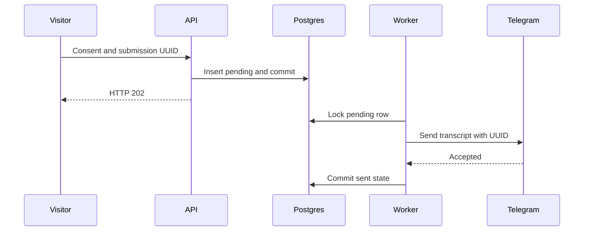

# Phase 9 study guide — recruiter handoff, sharing, and durable operations

Practice explaining how one recruiter question becomes a grounded answer, a
consented follow-up, or a signal for evaluation. Use the [review evidence](../audits/2026-11-12-phase-09-recruiter-workflow.md) and the [production runbook](../runbooks/production.md) for the operational details.

## 1. Company context selects emphasis

`?for=ecolab-5a2b` is a public selector. A suffix reduces casual guessing.
Possession of a company URL has no effect on permissions.

1. [companies.yaml](../../backend/app/data/companies.yaml#L1) supplies a greeting, two project IDs, three prompts, and an authored note.
2. [`load_company_contexts`](../../backend/app/companies.py#L49) validates the YAML and resolves project IDs through the project catalog. The resulting mapping lives on the application state.
3. [`resolve_company`](../../backend/app/api/context.py#L14) looks up the exact value of `for`. A missing lookup yields `None`. The context route returns the validated record and can queue a company-open event.
4. [`App.tsx`](../../frontend/src/App.tsx#L50) sends the URL parameter to the context hook and passes the resolved slug to chat. The cover can render the default experience during the fetch.
5. The [JSON chat path](../../backend/app/api/chat.py#L228) and [SSE path](../../backend/app/api/chat.py#L457) resolve the company on the server and pass only the authored note into prompt construction. Retrieved facts still supply the evidence.

**Interview question.** How would you prevent a URL query from changing the model’s instructions?

**Answer.** I would treat the query as an untrusted lookup key. The server
resolves it against a validated catalog, sends the authored note under a
separate prompt section, and preserves the same facts and instructions for
every company. Unknown values use the ordinary flow. [FastAPI query parameters](https://fastapi.tiangolo.com/tutorial/query-params/)

## 2. Postgres and async transaction ownership

A schema is a namespace. A role grant controls who may use its objects. A
foreign key preserves a relationship even if several application paths write
to the database. An index helps a query find matching rows with less work and
adds work to writes. A transaction defines what commits together.

1. [`create_database_engine`](../../backend/app/db/session.py#L38) validates the connection through the URL helper, builds the asyncpg engine, and caps the runtime pool at two connections. The first database operation establishes the connection.
2. [`lifespan`](../../backend/app/main.py#L75) creates the session factory and starts configured workers. Cleanup callbacks run in reverse order so workers stop before the engine is disposed.
3. [`models.py`](../../backend/app/db/models.py#L38) defines the `portfolio` schema tables. Read `sessions → messages → feedback` through the foreign keys and `ON DELETE CASCADE`. Handoffs can survive an inactive session purge through `ON DELETE SET NULL`.
4. [`env.py`](../../backend/alembic/env.py#L19) connects Alembic with the schema metadata and the dedicated revision table. Revisions `0001` through `0004` build the schema, extend analytics, add quota grants, and install retention. The application connects with a runtime role, and the migration shell uses its own role.

**Interview question.** Why create a session inside each `sessions.begin()` block?

**Answer.** An `AsyncSession` carries one unit of work and its transaction state.
I share the factory across tasks and let each task own its session. That keeps
the write, commit, rollback, and connection release scoped to the operation.
The pool caps simultaneous connections. [SQLAlchemy asyncio](https://docs.sqlalchemy.org/en/20/orm/extensions/asyncio.html#using-asyncsession-with-concurrent-tasks)

## 3. Handoff and delivery ambiguity

The handoff row serves as a durable work queue. Once the request commits, a
worker can recover the pending row after restart. An external send and a
Postgres commit have independent outcomes.

1. [`weak_evidence`](../../backend/app/api/chat.py#L86) checks retrieval. When handoff is configured, weak evidence short-circuits both chat transports. The model can also request `offer_handoff` during a tool round.
2. [`useChat`](../../frontend/src/hooks/useChat.ts#L250) attaches a UUID when the stream offers handoff. [`HandoffCard`](../../frontend/src/components/Chat/HandoffCard.tsx#L10) previews the messages and requires consent before sending. The card preserves the submission UUID on retries.
3. [`HandoffRequest`](../../backend/app/handoff.py#L43) enforces consent, the empty honeypot, valid Unicode, an optional reply email, up to ten messages, and at least one visitor message. [`submit_handoff`](../../backend/app/api/handoff.py#L28) applies the limit before saving.
4. [`Handoffs.accept`](../../backend/app/handoff.py#L130) inserts the pending row and checks the saved content on a UUID conflict. The transaction commits before HTTP 202 and before the worker wake signal.
5. [`_deliver_one`](../../backend/app/handoff.py#L166) locks one pending row with `FOR UPDATE SKIP LOCKED`. The notifier sends a plain message or text attachment under a bounded timeout. The worker records `sent` or `failed` in Postgres.

**Interview question.** What if Telegram accepts the message and the API
process dies before the database commit?

**Answer.** The row can remain pending and a later worker can send again. The
UUID makes the two messages identifiable. The unique database key deduplicates
visitor submissions. Delivery after the external send has an ambiguity window
because the provider has no transaction in common with Postgres. The accepted
row and the delivered notification therefore have separate evidence. [PostgreSQL row locks](https://www.postgresql.org/docs/18/explicit-locking.html#LOCKING-ROWS) · [Telegram Bot API](https://core.telegram.org/bots/api#sendmessage)

## 4. Analytics, feedback, and admin

HMAC lets the service join activity while withholding the raw IP from the
analytics tables. A keyed hash is still a stable identifier within its scope.
The stored question itself can also contain identifying text. Access controls
and retention still matter.

1. [`get_analytics`](../../backend/app/db/analytics.py#L201) derives a keyed IP hash and coarse device class. [`AnalyticsRequest.record`](../../backend/app/db/analytics.py#L150) derives a session UUID from the IP hash, tab ID, and resolved company. Chat records question text, known usage when supplied, and whether a handoff was offered.
2. [`AnalyticsWriter.enqueue`](../../backend/app/db/analytics.py#L54) queues an event without waiting for Postgres. The worker writes in a separate transaction. A full queue, database outage, or abrupt exit can lose analytics events while the recruiter still receives an answer.
3. [`submit_feedback`](../../backend/app/api/feedback.py#L47) waits briefly for the corresponding queued answer and inserts only for an existing message. The feedback primary key is the message ID. `ON CONFLICT DO NOTHING` leaves the first rating and reason in place.
4. [`require_admin`](../../backend/app/api/admin.py#L20) checks one bearer header with `secrets.compare_digest`, rate-limits attempts, then gives the handler a session factory. [`AdminPage`](../../frontend/src/components/Admin/AdminPage.tsx#L113) keeps the bearer in React memory. Signing out or reloading clears it.
5. [`get_dashboard`](../../backend/app/api/admin.py#L51) reads a repeatable, read-only snapshot. [`load_dashboard`](../../backend/app/db/dashboard.py#L112) aggregates seven UTC dates. Handoff-offer rate divides by classified questions, and unknown token usage stays separate. The candidate queue surfaces downvotes for review before any eval dataset update.

**Interview question.** Why can the browser show a reply while a vote later
receives a 404 or 503?

**Answer.** The reply is independent of optional analytics. The feedback ID
indicates an event was queued. A failed database write can leave no answer row
to vote on. The frontend can report that outcome without losing the reply. This
is a deliberate trade for chat availability. [PostgreSQL transaction isolation](https://www.postgresql.org/docs/18/transaction-iso.html) · [Python `secrets.compare_digest`](https://docs.python.org/3/library/secrets.html#secrets.compare_digest)

## 5. A forwardable summary is a capability URL

Anyone who holds the URL can read the summary until expiry. The application
stores the SHA-256 digest of 32 random bytes encoded for a URL. The digest can
be used for lookup and gives a database reader no practical way to recover
the random original token. A copied or logged URL still grants access.

1. [`App.tsx`](../../frontend/src/App.tsx#L78) offers sharing after two completed replies. The fit flow can also offer it after a completed report. The creation body carries up to two allowlisted project IDs.
2. [`build_summary`](../../backend/app/summary.py#L97) selects authored résumé evidence, points to confirm, availability guidance, and Aamir’s public contact. It builds a deterministic snapshot without an inference call.
3. [`create_summary`](../../backend/app/api/summary.py#L59) generates the token, sets a 30-day expiry, and inserts the snapshot with the digest. The response returns the raw token for the link. [`read_summary`](../../backend/app/api/summary.py#L94) queries by digest and expiry, returning the same 404 for a missing or expired link.
4. [`SummaryPage`](../../frontend/src/components/Summary/SummaryPage.tsx#L15) loads the public-by-link snapshot. The API and hosting configuration supply no-store, noindex, and no-referrer controls. The [print CSS](../../frontend/src/styles/summary.css#L91) removes the toolbar and supplies page padding for a one-page printout.

**Interview question.** What does `noindex` protect, and what still matters if
someone forwards the URL?

**Answer.** `noindex` tells compliant search crawlers to leave the page out of
their index. A recipient can open it because the URL is the capability. Random
tokens, expiry, response controls, and excluding recruiter text reduce the
consequences of forwarding and accidental exposure. [Python `secrets`](https://docs.python.org/3/library/secrets.html#secrets.token_urlsafe) · [CSS printing](https://developer.mozilla.org/en-US/docs/Web/CSS/Guides/Media_queries/Printing)

## 6. Daily quota across restarts

Postgres records the amount reserved for each boot against a shared UTC-day
ceiling. The process tracks the individual attempts that use its own grant.
This keeps provider attempts independent of ongoing database availability.

1. [`BootQuota.authorize`](../../backend/app/safety/boot_quota.py#L50) validates the boot identity and UTC window before asking storage to reserve. An automatic request may receive a partial grant. An operator request is exact.
2. [`PostgresQuotaStore.reserve`](../../backend/app/db/quota.py#L41) initializes the shared day row if needed, locks it, checks for an existing grant with the same boot ID, then updates the daily total and inserts the grant in one transaction. Concurrent boots see the balance left by earlier commits.
3. [`InferenceLedger.authorize`](../../backend/app/safety/admission.py#L218) opens the ledger after confirmation and applies a 60-second warm-up. Each dispatch uses a local attempt permit. At expiry or exhaustion, new attempts are denied. A boot without a confirmed grant stays resting.
4. [`seal`](../../backend/app/safety/admission.py#L351) closes admission before providing a final charge for an idle, healthy ledger. [`settle`](../../backend/app/db/quota.py#L112) refunds unused capacity once. An uncertain attempt keeps its reservation and an interrupted boot can keep the whole grant charged until the next UTC day.

**Interview question.** If 120 requests remain and two boots each ask for 100
automatically, what can they get? What changes if the first boot dies?

**Answer.** Assuming tokens fit, the first committed reservation gets 100 and
the second gets 20. A crashed boot leaves its 100 charged because its final
usage was never confirmed. A healthy idle shutdown can return the unused share.
The daily ledger sees application reservations. Actual provider usage, independent
traffic, and rolling minute limits need their own accounting. [PostgreSQL explicit locking](https://www.postgresql.org/docs/18/explicit-locking.html)

## 7. Retention and recovery

Read-time expiry controls visibility immediately. Scheduled cleanup removes
stored records. A restore can bring back rows or external-delivery states from
an earlier point in time, so the restored system needs reconciliation.

1. [`0004_recruiter_retention.py`](../../backend/alembic/versions/0004_recruiter_retention.py#L15) installs a security-invoker function and revokes public execution. One timestamp drives the transaction. Questions, feedback, fit usage, and handoffs age independently. Inactive visits are removed, expired summaries are purged, and quota deletion uses old UTC dates.
2. The [retention runbook](../runbooks/production.md#phase-9-retention) schedules the function in Supabase. This keeps scheduling independent of the web worker. Check the first successful job and inspect its history after a pause.
3. The [restore runbook](../runbooks/production.md#phase-9-backup-and-restore) archives only `portfolio` and records the Alembic revision separately. Restore to an empty target, stamp the existing schema, apply later migrations, restore permissions, and rerun cleanup before traffic.
4. Compare pending handoff UUIDs with Telegram and reconcile same-day quota before enabling those workers. A snapshot can predate a successful external delivery or omit grants created after export.

**Interview question.** Why stamp the archive revision after `pg_restore`?

**Answer.** The archive already contains the schema objects for that revision.
Stamp records their version in Alembic’s separate table. Upgrade can then run
only the later migrations. Recording the wrong revision would misrepresent
which DDL has already run. [PostgreSQL `pg_restore`](https://www.postgresql.org/docs/18/app-pgrestore.html) · [Alembic `stamp`](https://alembic.sqlalchemy.org/en/latest/api/commands.html#alembic.command.stamp) · [Supabase Cron](https://supabase.com/docs/guides/cron/quickstart)

## Teach-back

Answer each in two or three sentences before reopening the relevant code.
Explain the state transition and name the evidence that would confirm it.

1. A recruiter opens an unknown company URL, asks an unanswerable question,
   and sees “Request received.” What did the server trust at each step, and
   what remains to verify in Telegram?
2. A hiring manager forwards a summary and the recipient opens it after 30 days,
   before the next cleanup run. What happens, and why can the stored row still
   exist at that point?
3. Two boots request 100 units each when 120 remain. The first boot dies and
   Postgres then becomes unreachable. What can the surviving boot use, and
   which evidence determines whether the first reservation can be reclaimed?
